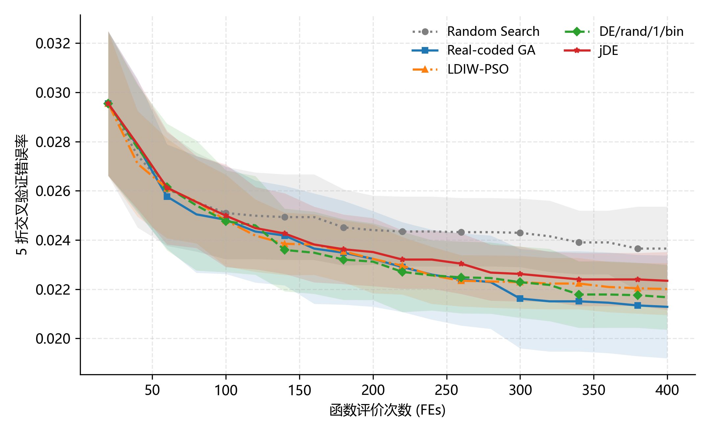
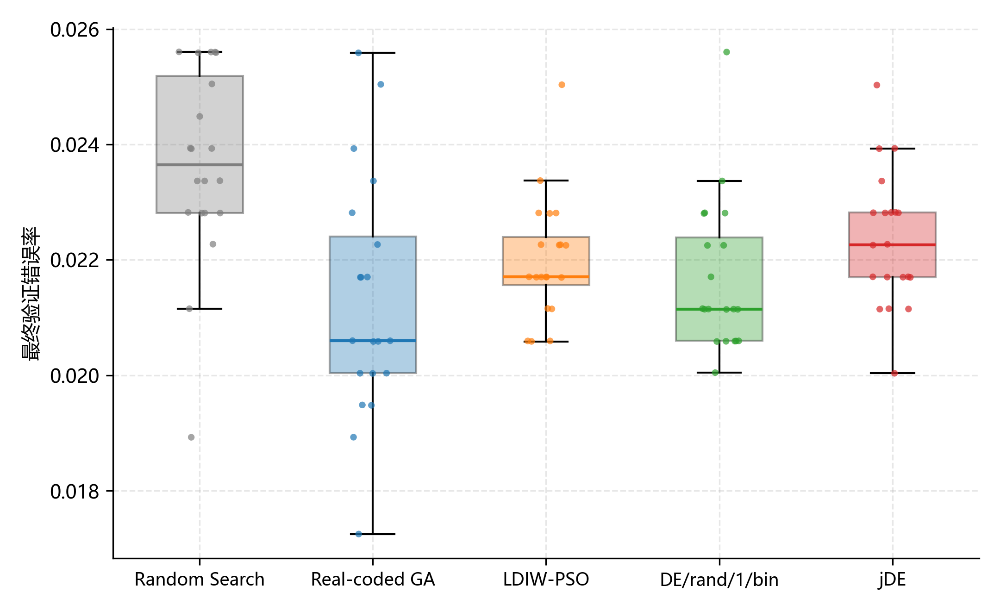
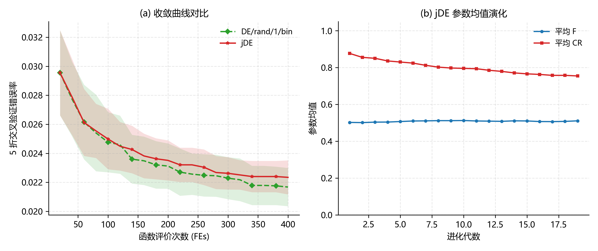

# Evolutionary Hyperparameter Optimization for Multi-Layer Perceptron

A reproducible comparison of five search strategies for tuning a two-layer MLP on
the scikit-learn `digits` dataset. The search space mixes continuous and integer
hyperparameters, so the objective is a black-box, mixed-variable optimization problem.
This repository contains the code, raw results, and figures for the course project
*Evolutionary Computation* at Jilin University.

## Problem Formulation

The classifier is a two-hidden-layer MLP trained with Adam and early stopping.
For a hyperparameter vector **x** = (x₁, x₂, x₃, x₄), the objective is the mean
5-fold stratified cross-validation error:

$$
f(\mathbf{x}) = 1 - \frac{1}{5}\sum_{k=1}^{5}\mathrm{Acc}_k(\mathbf{x})
$$

| Variable | Meaning | Search range | Decoding |
| --- | --- | --- | --- |
| x₁ | log₁₀ learning rate | [−5.0, −1.0] | α = 10ˣ¹ |
| x₂ | log₁₀ L2 penalty | [−6.0, −1.0] | λ = 10ˣ² |
| x₃ | first hidden layer size | [16, 256] | h₁ = round(x₃) |
| x₄ | second hidden layer size | [8, 128] | h₂ = round(x₄) |

`digits` has 1797 samples, 64 pixel features, and 10 classes. Pixels are scaled to
[0, 1]. Each run uses the same stratified folds for all algorithms.

## Implemented Algorithms

- **Random Search** — uniform sampling, used as the no-information-reuse baseline.
- **Real-coded GA** — 3-way tournament selection, whole arithmetic crossover
  (`pc = 0.8`), linearly decaying Gaussian mutation (`σ` from `0.15(u−l)` to
  `0.01(u−l)`), one elite.
- **LDIW-PSO** — global-best PSO with linearly decreasing inertia weight
  (`w: 0.9 → 0.4`), `c₁ = c₂ = 1.49445`, `Vmax = 0.15(u−l)`.
- **DE/rand/1/bin** — fixed `F = 0.5`, `CR = 0.9`.
- **jDE** — individual-level adaptation of `F` and `CR` with `τ₁ = τ₂ = 0.1`.

## Quantitative Results

Settings: population 20, 400 function evaluations per run, 20 independent runs,
seeds `2026 + r`. Lower error is better. The last column is a two-sided Wilcoxon
signed-rank test against jDE at α = 0.05 (`+` better, `−` worse, `≈` not significant).

| Algorithm | Best | Mean ± Std | Median | Worst | Time (s) | vs jDE |
| --- | ---: | ---: | ---: | ---: | ---: | :---: |
| Random Search | 0.0189 | 0.0237 ± 0.0017 | 0.0236 | 0.0256 | 649.4 | − |
| Real-coded GA | **0.0172** | **0.0213 ± 0.0021** | **0.0206** | 0.0256 | 395.8 | + |
| LDIW-PSO | 0.0206 | 0.0220 ± 0.0011 | 0.0217 | 0.0250 | 503.9 | ≈ |
| DE/rand/1/bin | 0.0200 | 0.0217 ± 0.0013 | 0.0211 | 0.0256 | 542.2 | + |
| jDE | 0.0200 | 0.0223 ± 0.0012 | 0.0223 | 0.0250 | 441.9 | — |

Wilcoxon p-values against jDE: Random Search 0.0042, Real-coded GA 0.0290,
LDIW-PSO 0.2179, DE 0.0458. At this small budget the individual parameter
adaptation of jDE did **not** improve over fixed-parameter DE; the full discussion
is in the course report.







## Quick Start

```bash
git clone https://github.com/LeiPan-JLU/evolutionary-hpo-mlp.git
cd evolutionary-hpo-mlp
pip install -r requirements.txt
python main.py
python plot_and_stats.py
```

`main.py` runs the five strategies in parallel shards and writes
`results/raw_results.csv`, `results/convergence_history.npy`, and
`results/jde_params_history.npy`. `plot_and_stats.py` writes
`results/statistics.csv` and the three figures. On a 32-core machine the full
run takes about 46 minutes.

## Notes on Reproducibility

- All algorithms share the same 20 initial samples and the same CV folds in a run.
- The MLP uses a fixed training seed; repeated hyperparameters are cached.
- Time is wall-clock time under 20 parallel processes and is intended for relative
  comparison only, not as a CPU-complexity measurement.

## Citation

```bibtex
@misc{pan2026ehpo,
  author = {Pan, Lei},
  title  = {Evolutionary Hyperparameter Optimization for Multi-Layer Perceptron},
  year   = {2026},
  url    = {https://github.com/LeiPan-JLU/evolutionary-hpo-mlp}
}
```

## License

MIT License, Copyright (c) 2026 Lei Pan.
